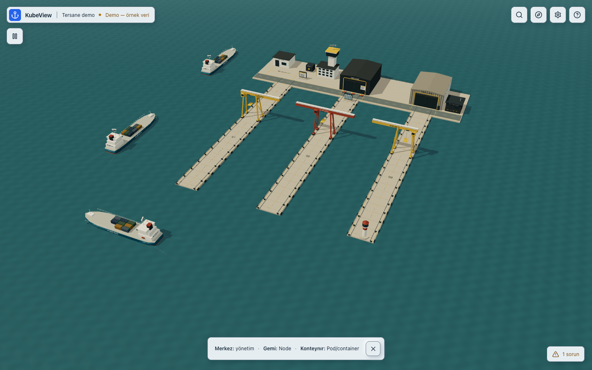

# KubeView / Tersane

Kubernetes kümenizin arayüzü, tam ekran etkileşimli bir tersanedir. Merkez binasına, Node gemisine veya Pod yüküne tıklayarak çalışırsınız. Kalıcı dashboard, sidebar veya açık kaynak tablosu yoktur. Listeler, formlar, grafikler ve loglar ilgili nesnenin geçici penceresinde açılır.

**Sürüm durumu:** **çoklu liman için 1.1.0 manuel kabul adayı geliştiriliyor**. Stable release yayımlanmadı; kullanıcının manuel onayı, eski CPU farkı ve fiziksel arayüz gecikmesi kapıları açık. Güncel kapsam ve kanıtlar [workspace kabul defterinde](docs/WORKSPACE_ACCEPTANCE.md), kullanıcı profilleri [manuel test rehberinde](MANUAL_TEST_GUIDE.md) tutulur. `32a0468` runtime / `594e090` kanıt / `0029672` paket kontrolü önceki tek-liman adayıdır; o testler yeni kodun otomatik kabulü değildir. Tarihsel platform ve build kimlikleri [release notlarında](docs/RELEASE_NOTES_v1.1.0.md); önceki CR/UID, gemi/container onarımı, worker ve Hubble kanıtları [onarım kaydında](docs/PRE_V11_VISUAL_REPAIR.md) korunur.

## Birden fazla proje, ayrı limanlar

Bir workspace, güvenilir Kubernetes bağlantıları ve bu bağlantılara bağlı proje/liman kayıtları içerir. Bir liman açık namespace kümesi ve isteğe bağlı label seçicisi kullanır. **Limanlar** pusulası veya merkez üzerinden eklenir; ilk boş kurulumda **İlk limanını bağla** açılır. İzinli namespace adı, namespace LIST izni olmadan elle girilebilir. Bağlantı ve kapsam gerçek API ile önizlenir. Liman kaydetmek, yeniden adlandırmak veya kaldırmak Kubernetes kaynaklarını yaratmaz, taşımaz veya silmez.

Aynı doğrulanmış cluster ve Node UID'si birden fazla projede **Paylaşılan Node** görünümü olabilir; bunlar ayrı sunucu değildir. Yalnız ilgili projenin yükleri gösterilir. Bilinmeyen cluster kimlikleri güvenli biçimde ayrı tutulur. Ortak altyapı, yapılandırılmış ilişki ve Hubble'dan ölçülmüş trafik farklı anlam taşır. Farklı kümeler tek scheduler/CPU havuzu değildir; doğrulanmış ağ altyapısı olmadan cross-cluster trafik iddiası yoktur.

Uygulama bir ayrıntılı Canvas kullanır; diğer limanlar uzak görünüm ve ortak veri abonelikleriyle temsil edilir. Paneller, kamera ve kaynak seçimi liman bağlamındadır. Yazma niyeti liman ve tarayıcı sekmesine bağlıdır; kayıt/import bunu açmaz. Paylaşılan Node ve diğer cluster kapsamlı işlemlerde etki ayrıca onaylanır. Label filtresi Kubernetes RBAC yerine geçmez.

Workspace, varsayılan kullanıcı yapılandırma dizinindeki `KubeView/workspace.json` dosyasına atomik ve yedekli yazılır. `--data-dir` ayrı profiller sağlar; bozuk/gelecek şema kullanıcı verisini sıfırlamaz. Güvenli export credential, mutlak kubeconfig yolu veya Secret taşımaz; import bağlantıları güvenilir context'e açıkça bağlanmadan erişim açmaz. Bu sözleşmelerin test durumu kabul defterindedir; kullanıcı manuel PASS/FAIL alanları önceden doldurulmaz.



## Kullanım

- **Merkez / kontrol kulesi:** Deployment ve workload oluşturma, kaynak kataloğu, gerçek olaylar ve metrikler.
- **Gemi:** gerçek Node; koşullar, o Node’daki Pod’lar, kapasite ve izinli bakım işlemleri. **Bu gemiye Pod ekle**, scheduler’ı atlamayan affinity formunu açar.
- **Yük grubu / kutu:** Pod ve belirli container; gerçek image, durum, kaynak ayarları, log, exec ve port-forward.
- **Vinç:** bekleyen yükler ve gözlenen scheduler olayları.
- **Depo, talimat panosu, kasa, ağ tesisi, fener ve personel bölümü:** ilgili gerçek kaynak türleri.

**Bul** veya **Cmd/Ctrl+K**, kaynak ve tesislere klavye ile erişir. **Limana dön**, genel kadraja döner. Paneller kapanırken canvas ve kamera korunur. Dar ekranda da ana görünüm limandır; ayrıntı paneli genişletilebilir alt sheet olur.

Bul penceresi mouse veya klavye ile açılabilir; ESC kapanışında odak açan kontrole döner. Input, YAML veya terminal odağı kameranın yön tuşlarını devralmasını engeller. Bir Pod/container seçiminde ham namespace/ad ve UID korunur; aynı adla yeniden oluşan kaynak ayrıca seçilir.

## Filo, deniz ve panel tercihleri

Sağlıklı Node gemileri varsayılan olarak kapalı ve güvenli su rotasında dolaşır. UID'ye bağlı seyir fazı kaynak güncellemesi, filtre veya pencere açılmasıyla sıfırlanmaz. Her bölgede en fazla **8 görünür gemi** vardır; bölge denetimi ve Bul bütün gerçek kaynaklara erişimi korur. Diğer bölgeler ek sahte Node üretmez. Normal tur yaklaşık **154 saniyedir**; duraklatma ve trafik bu süreyi uzatabilir.

Gözlenen yeni yük için uygun gemi geçici yanaşır, vinç işi bitince ayrılır. Görsel yaklaşma uzun sürecekse yaklaşık10 saniye sonra hedef gemide kısa varış kullanılır; bu, gerçek yanaşma olayı olarak kaydedilmez. Kanonik Node/Pod ataması ve Ready bilgisi animasyonları beklemez.

**Görünüm ve ayarlar**: seyir, hız, salınım, deniz, dalga şiddeti, iz, operasyon biçimi; sistem/azaltılmış/tam hareket; otomatik kalite; açık/koyu/sistem panel teması ve yüksek kontrast. Sol üstteki duraklatma düğmesi yalnız görsel hareketi durdurur. Node/Pod panelindeki **Görsel seyir ve kamera** bölümünden tek gemi durdurulabilir veya açıkça kamera takibi başlatılır. Elle kamera hareketi takibi bırakır. Bunlar Kubernetes cordon/scale işlemi değildir.

Deniz kapatılınca su fazı ve iz/salınım durur, yüzey yumuşakça statik hâle gelir; seyir ve gerçek veri akışı sürer. Tercihler sürümlü küçük yerel kayıtta doğrulanarak saklanır; depolama erişilemezse uygulama çalışmaya devam eder. Mat Neumorphism paneller opaktır; log/YAML/tablo yüzeyleri okunaklı tutulur.

Kanıt: [hareketli demo kaydı](docs/evidence/motion/demo-living-fleet.webm), [gerçek yanaşma döngüsü](docs/evidence/motion/live-docking-cycle.webm), [test ve ölçüm koşulları](docs/VALIDATION.md).

## Yerel kurulum ve kendi kümene bağlanma

Normal kullanım için çalışan bir Kubernetes kümesi, yalnız güvendiğiniz bir kubeconfig ve kimliğinizin ihtiyaç duyduğu mevcut auth plugin gerekir. Kubernetes kaynak koduna SDK eklenmez. Metrics API ve Hubble isteğe bağlıdır; yoklukları temel kaynakları incelemeyi engellemez. Gerçek küme olmadan yalnız açıkça seçilen demo kullanılabilir.

Hedef aday paketler `kubeview_1.1.0_darwin-arm64.tar.gz` ve `kubeview_1.1.0_linux-amd64.tar.gz` adlarını kullanır. Güncel macOS ARM64 binary temiz kurulum dizininden gömülü arayüzle ve gerçek normal UI ile çalıştırıldı. Linux AMD64 binary macOS ARM64 üzerindeki Docker emülasyonunda gerçek API ve gömülü asset kontrollerini geçti; native Intel/Linux browser veya performans kabulü bu kayıtta yoktur. Paketlerin yayımlanma durumu ve tam kimlikleri release notlarından kontrol edilmelidir. Doğrulanmış paket elinizde olduğunda macOS ARM64 örneği:

```sh
tar -xzf kubeview_1.1.0_darwin-arm64.tar.gz
cd kubeview_1.1.0_darwin-arm64
./kubeview --version
./kubeview --context kendi-context-adiniz
```

Linux AMD64 için dosya ve dizin adındaki `darwin-arm64` yerine `linux-amd64` kullanılır. Dağıtımın `SHA256SUMS` dosyasını aynı kaynaktan doğrulayın: macOS'ta `shasum -a 256 -c SHA256SUMS`, Linux'ta `sha256sum -c SHA256SUMS`. Her satırın denetlenmesi için listelenen arşivler aynı dizinde olmalıdır. Kaynaktan paket üretimi aşağıda açıklanır; henüz bir indirme/release adresi vaat edilmiyor.

Tarayıcıda `http://127.0.0.1:8000` açılır. Aynı Go süreci gömülü frontend'i, API'yi ve WebSocket'i sunar; günlük kullanım için Node, Go veya Vite başlatılmaz.

1. Boş workspace'te **İlk limanını bağla**, sonrakiler için küçük **Limanlar** pusulasından **Liman ekle** seçin. Demo ayrı ve açık seçimdir; bağlantı hatası demoya dönmez.
2. Liman adı ve mevcut/yeni güvenilir bağlantıyı seçin. **Cluster / context** sunucunun güvenilir kubeconfig bağlamlarını listeler; global `current-context` değişmez. Bir liman tek bağlantıya bağlıdır; aynı bağlantıda farklı projeler kaydedilebilir.
3. Açık namespace kümesini virgülle girin; isteğe bağlı label seçicisini belirtin. **Bağlantıyı dene ve kapsamı önizle** ardından kaydedin. Node/namespace LIST izni olmaması izinli Pod/Deployment erişimini ortadan kaldırmaz. Kapsam seçimi RBAC yetkisi vermez.
4. Bağlantı penceresinde tarayıcı/backend, Kubernetes API, discovery, kaynak okuma izinleri ve snapshot senkronizasyonunu ayrı inceleyin. Boş kapsam, Forbidden, eski veri, Metrics ve Hubble yokluğu ayrıca görünür. **Tanılamayı kopyala** yalnız izinli durum alanlarını kopyalar; token, kubeconfig, bağlantı nonce'u, kaynak içeriği ve ham hata mesajları bu özete dahil edilmez.
5. Gerçek kaynakları **Bul** ile arayın; Node gemisi veya Pod/container üzerinden ayrıntı açın. Bağlantı olmasa da merkez erişilebilir kalır. Boş namespace'e sahte yük eklenmez.

Başlangıç salt okunurdur. Yönetim gerekiyorsa sunucuyu `--write` ile başlatın, ardından bağlantı penceresinde **Yönetim modunu aç** eylemini açıkça seçin:

```sh
./kubeview --context kendi-context-adiniz --namespace kendi-namespace-adiniz --write
```

`--write` / `READ_ONLY=false` sunucu kilidini açar; Kubernetes rolü vermez ve tarayıcıyı kendiliğinden yazma moduna geçirmez. Her işlem gerçek Kubernetes yetkileriyle denetlenir. Context veya namespace değişince tarayıcı yazma niyeti iptal edilir; tekrar açık onay gerekir. API kabulü, controller uygulanması ve gözlenen Ready/tamamlanma ayrı gösterilir. Ağ hatasında sonucu belirsiz gönderim otomatik tekrarlanmaz; formdan gerçek kaynak durumu sorgulanır.

Yeniden bağlantıda yönetim durumu backend'den tekrar doğrulanır; backend izni kaldırmışsa açık panel de salt okunur olur. Aynı kaynak UID'sindeki kullanıcı taslağı gecikmiş GET ile ezilmez. Güncel sürüm yüklenirken form alanları bekler; resourceVersion değişmişse taslak korunur ve açık gözden geçirme gerekir. Önceki dry-run önizlemesi yeniden doğrulanır. Farklı context/namespace'e ait seçim, taslak ve akışlar yeni kümeye taşınmaz.

| Seçenek | Etkisi |
|---|---|
| `--kubeconfig PATH_LIST` | Güvenilir kubeconfig dosyalarını `KUBECONFIG` yüklemesine verir. macOS/Linux'ta çoklu yol `:` ile ayrılır. |
| `--context NAME` | İlk gerçek context'i seçer; global current-context değişmez. |
| `--namespace NAME` | Sunucunun namespaced okuma/yazma kapsamını sınırlar (`WATCH_NAMESPACE`). UI filtresinden farklı bir sunucu sınırıdır. |
| `--write` | Sunucu yazma kilidini açar; tarayıcı yönetim seçimi ve RBAC ayrıca gerekir. |
| `--port PORT` | Dinleme portu; varsayılan `8000`, geçerli aralık `1–65535`. |
| `--bind ADDRESS` | Dinleme adresi; varsayılan `127.0.0.1`. Loopback dışı adres erişim token'ı gerektirir. |
| `--api-token-file PATH` | En az 32 karakterlik, tek satırlık erişim token'ını dosyadan okur; token komut argümanına yazılmaz. |
| `--version` | Binary'ye gömülen sürüm, commit ve OS/CPU bilgisini gösterir. |
| `--data-dir PATH` | Workspace ve güvenli görünüm tercihleri için ayrı özel dizin (`KUBEVIEW_DATA_DIR`). Repo veya `.git` gerekmez. |
| `--replay-profile M\|L` | Yalnız açık TEST/REPLAY manuel yük profili. Loopback ve salt okuma zorunludur; gerçek kubeconfig yüklemez, gerçek kullanım metriği üretmez. |

Bayrak verilmezse mevcut ortam ayarları kullanılır. Standart yükleme `KUBECONFIG` dosya listesini birleştirir; yoksa yerel `~/.kube/config`, uygun ortamda in-cluster ServiceAccount değerlendirilir. Örnek çoklu dosya: `./kubeview --kubeconfig "$HOME/.kube/config:$HOME/.kube/ek-config" --context kendi-context-adiniz`. Kubeconfig ve kimlik bilgileri backend'de kalır. **Yalnız güvendiğiniz kubeconfig dosyalarını kullanın:** içindeki exec auth plugin'i backend makinesinde yerel program çalıştırabilir. TLS doğrulaması bağlantı hatasını gidermek için otomatik kapatılmaz.

Bağlanmak cluster kaynaklarını değiştirmez, Node eklemez veya ağ sağlayıcısı kurmaz. Mutasyonlar ayrı, açık kullanıcı eylemiyle ve sunucu kapsamı/RBAC denetimiyle çalışır.

Bayrakla açık `--context` seçimi, henüz workspace dosyası yoksa tek-liman kurulumunu bir defa taşır. Kayıtlı workspace her açılışta yeniden oluşturulmaz. `--context` vermeden yeni veri diziniyle başlamak boş onboarding'i korur. Yedi izole manuel profil ve yeniden başlatma komutları için [MANUAL_TEST_GUIDE.md](MANUAL_TEST_GUIDE.md).

`STATIC_DIR=/tam/yol/frontend ./kubeview` gömülü arayüz yerine belirtilen dizini sunar; dizinde `index.html` bulunmalıdır. Override güvenilir ve aynı adayın API'siyle uyumlu olmalıdır. Hazırlanmamış geliştirme derlemesinde dış statik dizin veya Vite yolu korunur.

## Kaynaktan derleme ve geliştirme

Kaynaktan üretimde Node/npm ve Go gerekir; repo `go.mod` alt sınırı 1.22'dir, Docker derlemesi Node 24 / Go 1.26 kullanır. Çalıştırılmış araç/platform sürümleri kabul raporundan ayrıca değerlendirilir.

```sh
make build
./bin/kubeview --context kendi-context-adiniz
```

`make build` frontend'i derleyip Go embed alanına hazırlar; `bin/kubeview` ve uyumluluk adı `bin/tersane-backend` oluşur. Aday arşivleri repo kökünde `node scripts/build-release.mjs` ile hazırlanır; varsayılan hedefler macOS ARM64 ve Linux AMD64, çıktı `dist/` altındadır. `--require-clean` izlenen runtime değişikliklerinin commitlenmesini ister. `--prepared` mevcut frontend build'ini kullanır; kaynak/build eşitliği doğrulanmadan release için kullanılmamalıdır. `dist/build.json` kaynak commit'ini kaydeder; çapraz derleme platform çalıştırma testi değildir.

Geliştirme ortamı:

```sh
./start.sh
```

Vite `http://127.0.0.1:5173` üzerinde `/api` ve `/ws` isteklerini aynı origin üzerinden backend’e iletir. Backend portunu değiştirirken `PORT=8002 API_TARGET=http://127.0.0.1:8002 ./start.sh` kullanın.

Yalnız bu görev için ayrılmış test ortamında yazma erişimi:

```sh
KUBE_CONTEXT=kubeview-test WATCH_NAMESPACE=kubeview-qa READ_ONLY=false ./start.sh
```

Bu geliştirme örneği de bağlantı penceresinden açık yönetim seçimi gerektirir. Genel cluster kapsamlı mutasyonlar namespace ile sınırlandırılmış bağlantıda kapalıdır; Node cordon/uncordon ayrı izinlerle değerlendirilir.

## Gerçek işlemler ve sınırlar

Discovery tabanlı list/get/create/edit/delete, server dry-run, UID/resourceVersion koruması, scale, uygun restart/rollback, container request/limit, koşullu `pods/resize`, CronJob işlemleri, cordon/uncordon ve eviction tabanlı drain servisi bulunur. Log/exec/port-forward gerçek Kubernetes alt kaynaklarını kullanır. Özellik ve test kapsamı [CAPABILITIES.md](docs/CAPABILITIES.md) içinde açıkça ayrılmıştır.

Merkez veya sefer panosundan Deployment oluştururken önce **Server dry-run**, sonra gerçek oluşturma kullanılır; dry-run nesne yaratmaz. Pod ataması, owner zinciri ve Ready durumu gerçek watch verisinden izlenir. Workload panelindeki **Ölçekle**, **CPU / RAM**, **Rollout restart** ve **Sil** kendi eylemidir. Pod silmek controller'ın yeni UID ile replacement yaratmasına yol açabilir; replica azaltma ve workload silme farklı sonuçlardır. CPU/RAM template düzenleme doğrulanmış Deployment/StatefulSet/DaemonSet hedefine uygulanır; standalone ReplicaSet/Job/CronJob için gerekçe gösterilir. RollingUpdate, OnDelete ve partition sonuçları aynı kabul eşiğiyle sunulmaz.

StatefulSet/DaemonSet CPU/RAM template düzenlemesinde bilinmeyen kullanıcı etiketleri/annotation'ları ve diğer container alanlarının korunması [gerçek form akışında doğrulandı](artifacts/v1.1.0/v11-20261108/frontend/forms-resume/REVIEW.md). Controller'ın kendi template-generation annotation değişimi bu kayıtta ayrıca ayrılır.

Kasa Secret değerlerini toplu akışta taşımaz; ayrı **Yetkiyle Secret değerlerini aç** ve **Gizli içeriği düzenle** yolları gerçek yetki ister. Maskeli placeholder gerçek Secret değeri olarak geri yazılmaz. Container loglarında app, tamamlanmış init, geçici debug ve previous/current seçimi gerçek container adını kullanır. **Duraklat**, HTTP log akışını kapatır; devam et seçili son satır sayısını yeniden alır, aradaki bütün satırların saklanmasını garanti etmez. Askıdaki Job **Askıya alındı** görünür; DaemonSet ancak bilinen ready/desired sayıları ve güncel observedGeneration ile **Hazır** sayılır.

`metrics.k8s.io` gerçek CPU/RAM ölçümlerini sağlar; grafikler ölçüm zamanını ve birimini gösterir. Request/limit/allocatable kullanım ölçümü değildir. Ölçüm yoksa/Forbidden ise sahte sıfır çizilmez. Geçmiş yalnız oturum belleğindedir; Prometheus gibi uzun geçmiş deposu değildir. Exec arayüzü non-TTY satır tabanlı shell'dir. Kullanıcıya sunulan port-forward yolu seçili Pod'un TCP portundaki **HTTP önizlemesidir**; genel ağ proxy'si veya UDP desteği vaat edilmez. Önizleme sandbox uygular; mutlak asset yolları kullanan karmaşık uygulamalar sınırlıdır. Log UID guard'ları aynı-ad/yeni-UID yarışını sınırlar; Kubernetes logs API'si atomik UID önkoşulu sunmadığından mutlak UID-pinned log garantisi yoktur. Helm release yönetimi ve genel bulut worker sağlama yoktur; izinli yerel minikube worker ve gerçek Hubble akışı aşağıdaki sınırlı sağlayıcılardır.

Görsel kanıt: [önceki dashboard](docs/evidence/chromium-overview-1440.png) → [tam ekran dünya](docs/evidence/world/chromium-world-1440.png) · [gerçek yaşam döngüsü videosu](docs/evidence/world/lifecycle-live.webm). Test ortamı, ölçümler ve açık sınırlar: [VALIDATION](docs/VALIDATION.md).

## Doğrulama

Güncel seri frontend unit grubu **165/165 PASS** içerir. Son beş vaka gerçek `useWorldProviders` hook'unu sentetik deferred yanıtlarla sınar: A→B→A, namespace ve stream-session değişiminde eski Hubble UID/protokol verisi modele girmez, güncel nonempty yanıt kabul edilir ve pinned lease cleanup korunur. Bunlar gerçek Hubble E2E yerine geçmez. [Unit kanıtı](artifacts/v1.1.0/v11-20261108/frontend/provider-epoch-evidence.json), [gerçek Job/DS UI kabulü](artifacts/v1.1.0/v11-20261108/frontend/status-resume/REVIEW.md) ve bütün kabul satırlarının [durumu](docs/V11_ACCEPTANCE_REPORT.md) ayrı kayıtlardır.

```sh
make test
npm --prefix frontend run test:e2e
KUBEVIEW_TEST_CONTEXT=kubeview-test KUBEVIEW_TEST_NAMESPACE=kubeview-qa \
  npm --prefix frontend run test:e2e -- --project=chromium live.spec.js
cd backend
KUBEVIEW_TEST_CONTEXT=kubeview-test KUBEVIEW_TEST_NAMESPACE=kubeview-qa \
  KUBEVIEW_TEST_CLUSTER_UID=dogrulanmis-kube-system-uid \
  go test -race ./pkg/server -run TestDedicatedCluster -v
```

Production performans altyapısı, gerçek Go informer → WebSocket → store → mevcut sahne yolunu deterministik sentetik verilerle kullanır. Gerçek kümeye kaynak uygulamaz. S/M/L profilleri, 30 sn ısınma + 60 sn ×3 tekrar, efekt/olay/etkileşim koşuları ve 20 dakikalık kaynak/log/reconnect döngüsü için [ölçüm kılavuzuna](docs/PERFORMANCE.md) bakın. Ölçülen sonuçlar ve native Safari erişim sınırı [performans raporunda](docs/PERFORMANCE_REPORT.md) ayrılır. Önceki `e2e/fleet-benchmark.mjs` geliştirme tanılaması production benchmark yerine kullanılmaz.

Son aday için 31 AC hücresi ve ayrı dört kontrollü pil hücresi tamamlandı; AC karşılaştırma kaydı `valid=true/partial=false` döner. 20 dakikalık sentetik koşuda 20 panel döngüsü ve 24/24 log kapanışı bulunur. [Ham ölçüm kapsamı](artifacts/v1.1.0/v11-20261108/performance/raw-measurements-manifest.json) ve [AC karşılaştırması](artifacts/v1.1.0/v11-20261108/performance/comparison-ac.json) kaynak/güç koşullarına bağlıdır. Pil ile AC oranlanmaz; JS çizim sıklığı fiziksel presented FPS, sentetik replay de gerçek provider maliyeti değildir. Yayın kararı kalan final kanıt/CI/release kapılarına bağlıdır.

26–30 Ekim panel araştırması, güncel sınırlı-log sürümünü yeni baseline olarak kullanır: [panel CPU deneyi ve tekrarlama](docs/PANEL_CPU_OPTIMIZATION.md). Beş çiftte dolu-log takılması ve süreç RSS'i azaldı; net toplam CPU kazanımı kanıtlanmadı. Açık/kapalı panel farkı aynı seçili UID ile eşleşmiş bloklarda ölçülür; tarihsel sürümler arasındaki fark panel açma maliyeti sayılmaz. Son doğrulama durumu ve reddedilen kapasite adayı da raporda ayrı tutulur.

```sh
npm --prefix frontend run bench:test
npm --prefix frontend run bench:run -- --phase optimized --profiles M --scenarios living
npm --prefix frontend run bench:compare -- BEFORE_DIR AFTER_DIR OUTPUT.json
```

`--phase` dondurulan build'i, `--profiles` kaynak yükünü, `--scenarios` ölçüm akışını seçer. Var olan build tekrar kullanılacaksa `--reuse-build --reuse-binary` eklenir; tarihsel baseline güncel kodla ezilmez. Log ekranının yerel geçmişi 5000 satır / 1 MiB ve satır başına16 KiB ile sınırlıdır; kısaltma görünür biçimde bildirilir. Ham Kubernetes log verisi değiştirilmez.

Tarihsel tarayıcı testleri çalışan Vite/backend bekler; yeni v1.1 gerçek-küme suite'i `frontend/e2e/v11-playwright.config.js` altında production sunucusunu hedefler. `npx playwright install chromium webkit` komutu frontend dizininden gerekli motorları kurar. Canlı mutasyon testleri açık test context'i, namespace'i ve ilgili harness'in cluster UID/sahiplik kontrolleri olmadan çalıştırılmamalıdır; üretim context'i otomatik seçilmez. Yukarıdaki UID bir yer tutucudur. `SKIP` gerçek küme testi geçti anlamına gelmez. Native Safari, Playwright WebKit ve çapraz derlenmiş platform kanıtları ayrı tutulur.

## Paketleme

```sh
docker build -t kubeview:local .
helm lint charts/tersane
helm template kubeview charts/tersane >/dev/null
```

Docker varsayılan olarak container'ın dış arayüzüne bind ettiği için `API_TOKEN` gerektirir. Host yayını gerekiyorsa yalnız loopback'e yayınlayın (`-p 127.0.0.1:8000:8000`) ve özel token dosyasını `--api-token-file` ile container'a salt okunur bağlayın. Host kubeconfig/auth plugin yollarını container'a rastgele taşımayın; dosyalar, sertifika başvuruları ve gerekli plugin container ortamıyla uyumlu olmalıdır.

İkinci model Kubernetes içinde mevcut ServiceAccount ile çalışmadır. Helm `ClusterIP` erişimi ve release'e ait token Secret'ı veya `auth.existingSecret` kullanır. Image repository/tag ayarı, image'ın gerçekten yayımlandığının kanıtı değildir; doğrulanmış image'ı açıkça seçin. Paylaşılan erişimde bütün kullanıcılar aynı gateway Kubernetes kimliğini kullanır; kullanıcı bazlı Kubernetes impersonation veya SaaS hesap/rol ayrımı yoktur. Tek operatör/özel ağ sınırını koruyun. Yazma, exec, port-forward ve Node bakımı izinleri ayrı opt-in değerlerdir.

Minimum izin örnekleri, `kubeview-example` yerine önceden var olan ve yönettiğiniz namespace yazılarak değerlendirilir:

- [Namespace okuyucu](deploy/rbac-namespace-readonly.yaml): ServiceAccount, sınırlı Role ve RoleBinding; varsayılan Secret, exec, RBAC yönetimi veya Node yazması yok.
- [İsteğe bağlı workload yazma](deploy/rbac-namespace-write.yaml): seçili namespace için D/STS/DS yönetimi ve Pod create/delete; backend ve tarayıcı kilitleri ayrıca gerekir.
- [İsteğe bağlı log ve Pod metrics](deploy/rbac-namespace-observability.yaml): `pods/log` ve `metrics.k8s.io` Pod okuma izinleri.
- [İsteğe bağlı Node/Node metrics okuma](deploy/rbac-node-observability.yaml): küme kapsamlı ek izin; namespace uygulaması için zorunlu değildir.

Manifestler yetki örneğidir; addon kurmaz ve kullanıcının gerçek RBAC sonucunu değiştirmiş gibi gösterilmez. Kendi kullanıcı kimliğinizin mevcut kubeconfig erişimiyle yerel kullanımda yeni ServiceAccount oluşturmanız gerekmez. Credential içeren dosyaları depoya eklemeyin.

## Erişim sınırı ve kaldırma

Varsayılan `127.0.0.1` HTTP dinleyicisini koruyun. Uzak makinede çalışan tek operatör kurulumu için gateway'i orada da loopback'te bırakıp SSH tüneli açabilirsiniz: `ssh -N -L 127.0.0.1:8000:127.0.0.1:8000 operator@sunucu`. Yerel tarayıcı aynı `http://127.0.0.1:8000` adresini kullanır. In-cluster kurulumda benzer biçimde explicit context ve namespace ile `kubectl --context kendi-context-adiniz --namespace kubeview port-forward --address 127.0.0.1 service/kubeview-tersane 8000:8000` kullanılır; Service adını gerçek Helm release'inize göre doğrulayın. Token gerektiren sunucuda bağlantı penceresinden erişim anahtarıyla oturum açın.

Token dosyası örneği: `umask 077` ardından `openssl rand -hex 32 > kubeview.token`; uygulamayı `./kubeview --api-token-file ./kubeview.token` ile başlatın. Dosyayı paylaşmayın veya repoya eklemeyin. HTTP/WS isteği tarayıcının gerçek scheme + Host/port origin'iyle eşleşmelidir. `X-Forwarded-*` güvenilir kabul edilmez; mevcut gateway'de TLS dinleme bayrağı veya otomatik TLS sonlandıran reverse proxy desteği vaat edilmez. Origin denetimini gevşeterek proxy bağlamayın. Ayrıntılı sınırlar: [SECURITY](docs/SECURITY.md).

Yerel kaldırma için süreci `Ctrl+C` ile durdurun, kurduğunuz binary ve açtığınız paket dizinini kaldırın. Tarayıcı site verisini temizlemek görünüm tercihlerini ve oturum cookie'lerini kaldırır; backend yeniden başlatılması bellekteki yönetim oturumlarını kapatır. Kubeconfig, küme, uygulama workload'ları veya minikube makineleri bu işlemle silinmez. Sağlayıcı kullanıldıysa journal varsayılan olarak `~/.local/state/kubeview/providers` altındadır (`KV_PROVIDER_STATE_DIR` ile değişebilir). Açık/belirsiz worker işlemi varsa envanterini uzlaştırmadan bu journal'ı silmeyin. Helm kaldırma yalnız kendi KubeView release'ini hedeflemeli; örnek RBAC manifestlerinden kalan yalnız size ait nesneleri ayrıca gözden geçirin. Kullanıcı workload'ları, PVC'leri veya namespace'leri kaldırma adımı yoktur.

Mimari: [ARCHITECTURE](docs/ARCHITECTURE.md) · dünya eşleştirmeleri: [METAPHOR](METAPHOR.md) · tasarım: [UI-UX](docs/UI-UX.md) · gerçek durum: [ROADMAP](docs/ROADMAP.md).

### İsteğe bağlı gerçek worker ve trafik sağlayıcıları

Tam ekran dünyada merkez → **Sağlayıcılar / Worker ekle** yerel minikube işlem kaydını açar. Sağlayıcı kapalıysa gerekçesi görünür; taslak gemi gerçek Node sayılmaz. Aşağıdaki örnekte değerleri yalnız yönettiğiniz test profiline göre verin:

```sh
READ_ONLY=false \
KV_MINIKUBE_ENABLED=true \
KV_MINIKUBE_PROFILE=your-test-profile \
KV_MINIKUBE_CONTEXT=your-test-context \
KV_MINIKUBE_CLUSTER_UID=verified-kube-system-uid \
KV_MINIKUBE_MAX_NODES=3 \
./kubeview --context your-test-context --write
```

`READ_ONLY=false` sunucu yazma kilidini açar; tarayıcıda açık yönetim seçimi ayrıca gerekir. Profil/context/UID sabit allowlist'tir. İlk adaptör minikube1.38.1/docker üzerinde sınandı. `KV_MINIKUBE_HOME` profil dizinini, `KV_PROVIDER_STATE_DIR` özel kalıcı journal/lock dizinini belirler. Açık/sonucu belirsiz işlem ikinci worker'ı otomatik oluşturmaz. İptal veya timeout oluşmuş makineyi silmez; envanter uzlaştırılmadan kör retry yapılmaz. Yerel operatör erişimi ve Kubernetes `nodes create` yetkisi ayrıca denetlenir. Gerçek Ready sonucu görsel katılımı beklemez. Filoya giriş, gemi gövdeleri ve rota takip mesafesi güvenliyken başlar; yoğun trafikte bekleyebilir.

**Görünüm ve ayarlar → Ölçülmüş trafik — Hubble** opsiyonel gerçek flow katmanıdır. CNI/agent uygulama tarafından kurulmaz. Operatörün mevcut Hubble relay'ine backend'den TLS ile erişebilmesi ve resmi Hubble CLI1.20.2'nin kurulu olması gerekir:

```sh
KV_HUBBLE_ENABLED=true \
KV_HUBBLE_CONTEXT=your-observer-context \
KV_HUBBLE_CLUSTER_UID=verified-kube-system-uid \
KV_HUBBLE_CLUSTER_NAME=your-cilium-cluster-name \
KV_HUBBLE_SERVER=relay.example:4245 \
KV_HUBBLE_TLS_CA=/private/ca.crt \
KV_HUBBLE_TLS_CERT=/private/client.crt \
KV_HUBBLE_TLS_KEY=/private/client.key \
KV_HUBBLE_TLS_SERVER_NAME=relay.example \
./kubeview --context your-observer-context
```

`KV_HUBBLE_BINARY` varsayılan `hubble` yerine sabit bir executable yolu verebilir. Sağlayıcı kimliği context/clusterUID/API TLS binding ve gerçek Cilium cluster.name ile sınırlandırılır. Namespace yetkisi ayrıca uygulanır; relay sertifikası uygulama kullanıcısına tüm namespace yetkisi vermez. Flow olayları10sn pencerede toplanır; paket, byte veya bant genişliği değildir. L7 yalnız sağlayıcı kaydı varsa görünür; şifreli içerik çıkarılmaz. UID/kimlik belirsizliği, kapasite sınırları ve eski veri açıkça belirtilir. Selector/EndpointSlice çizgileri ayrı yapılandırma katmanıdır.

Tarihsel Node arızası/worker/vinç sağlayıcı kanıtları [v1.1 öncesi onarım kaydında](docs/PRE_V11_VISUAL_REPAIR.md) kalır; güncel [kaynak uygulanabilirliği](artifacts/v1.1.0/v11-20261108/harbor-source-applicability.json) ve [son runtime farkı](artifacts/v1.1.0/v11-20261108/source-applicability-32a0468.json) hangi modüllerin korunduğunu belirtir. Bunlar yeni bir gerçek Node stop veya worker-add koşusu olarak sayılmaz. Değişen caption'lar ayrı gerçek container/flow UI [kanıtıyla](artifacts/v1.1.0/v11-20261108/frontend/visual-resume/REVIEW.md) incelendi. Adayın yayın ve kabul durumu [release notlarından](docs/RELEASE_NOTES_v1.1.0.md) izlenir.
