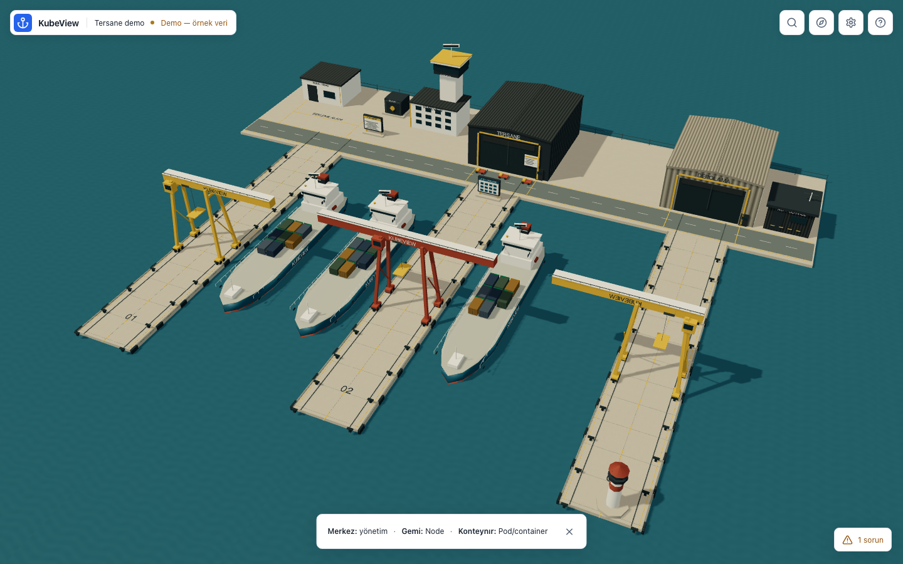

# KubeView / Tersane

Kubernetes kümenizin arayüzü, tam ekran etkileşimli bir tersanedir. Merkez binasına, Node gemisine veya Pod yüküne tıklayarak çalışırsınız. Kalıcı dashboard, sidebar veya açık kaynak tablosu yoktur. Listeler, formlar, grafikler ve loglar ilgili nesnenin geçici penceresinde açılır.



## Kullanım

- **Merkez / kontrol kulesi:** Deployment ve workload oluşturma, kaynak kataloğu, gerçek olaylar ve metrikler.
- **Gemi:** gerçek Node; koşullar, o Node’daki Pod’lar, kapasite ve izinli bakım işlemleri. **Bu gemiye Pod ekle**, scheduler’ı atlamayan affinity formunu açar.
- **Yük grubu / kutu:** Pod ve belirli container; gerçek image, durum, kaynak ayarları, log, exec ve port-forward.
- **Vinç:** bekleyen yükler ve gözlenen scheduler olayları.
- **Depo, talimat panosu, kasa, ağ tesisi, fener ve personel bölümü:** ilgili gerçek kaynak türleri.

**Bul** veya **Cmd/Ctrl+K**, kaynak ve tesislere klavye ile erişir. **Limana dön**, genel kadraja döner. Paneller kapanırken canvas ve kamera korunur. Dar ekranda da ana görünüm limandır; ayrıntı paneli genişletilebilir alt sheet olur.

## Yerel çalıştırma

Node 22+ ve Go 1.25+ ile:

```sh
make build
./bin/tersane-backend
```

`http://127.0.0.1:8000` hem uygulamayı hem API/WS’yi sunar. Varsayılan bağlantı salt okunur ve loopback ile sınırlıdır. Frontend statik dosyaları binary’nin içine gömülmez; `frontend/dist` veya `STATIC_DIR` birlikte gerekir.

Geliştirme:

```sh
./start.sh
```

Vite `http://127.0.0.1:5173` üzerinde `/api` ve `/ws` isteklerini aynı origin üzerinden backend’e iletir. Backend portunu değiştirirken `PORT=8002 API_TARGET=http://127.0.0.1:8002 ./start.sh` kullanın.

Yalnız bu görev için ayrılmış test ortamında yazma erişimi:

```sh
KUBE_CONTEXT=kubeview-test WATCH_NAMESPACE=kubeview-qa READ_ONLY=false ./start.sh
```

`KUBE_CONTEXT` gerçek kubeconfig context’ini seçer; diskteki current-context’i değiştirmez. `WATCH_NAMESPACE` namespaced okuma/yazma kapsamını sınırlar. `READ_ONLY=false` yalnız backend kilidini açar; her işlem ayrıca Kubernetes RBAC denetiminden geçer. Genel cluster kapsamlı mutasyonlar namespace ile sınırlandırılmış bağlantıda kapalıdır; Node cordon/uncordon ayrı izinlerle değerlendirilir.

Bağlantı rozeti gerçek context ve namespace seçimini açar. Kubeconfig ve Kubernetes credential’ları Go tarafında kalır. Kubeconfig yokken tesisler erişilebilir kalır; örnek Node üretilmez. **Demo — örnek veri** yalnız açık seçimle açılır ve canlı mutasyonları kapatır.

## Gerçek işlemler ve sınırlar

Discovery tabanlı list/get/create/edit/delete, server dry-run, UID/resourceVersion koruması, scale, uygun restart/rollback, container request/limit, koşullu `pods/resize`, CronJob işlemleri, cordon/uncordon ve eviction tabanlı drain servisi bulunur. Log/exec/port-forward gerçek Kubernetes alt kaynaklarını kullanır. Özellik ve test kapsamı [CAPABILITIES.md](docs/CAPABILITIES.md) içinde açıkça ayrılmıştır.

metrics.k8s.io ölçümleri oturum belleğinde örneklenir; Prometheus gibi uzun geçmiş deposu değildir. Exec arayüzü non-TTY satır tabanlı shell’dir. HTTP port-forward önizlemesi sandbox uygular; mutlak asset yolları kullanan karmaşık uygulamalar sınırlıdır. Helm release yönetimi, bulut worker sağlama ve ölçülmüş ağ trafiği entegrasyonu yoktur.

Görsel kanıt: [önceki dashboard](docs/evidence/chromium-overview-1440.png) → [tam ekran dünya](docs/evidence/world/chromium-world-1440.png) · [gerçek yaşam döngüsü videosu](docs/evidence/world/lifecycle-live.webm). Test ortamı, ölçümler ve açık sınırlar: [VALIDATION](docs/VALIDATION.md).

## Doğrulama

```sh
make test
npm --prefix frontend run test:e2e
KUBEVIEW_TEST_CONTEXT=kubeview-test KUBEVIEW_TEST_NAMESPACE=kubeview-qa \
  npm --prefix frontend run test:e2e -- --project=chromium live.spec.js
cd backend
KUBEVIEW_TEST_CONTEXT=kubeview-test KUBEVIEW_TEST_NAMESPACE=kubeview-qa \
  go test -race ./pkg/server -run TestDedicatedCluster -v
```

Sentetik GPU profili için frontend dizininde `node e2e/gpu-profile.mjs` (headed Chromium, Metal ister); 10 dakikalık yazılım renderer/bellek döngüsü için `node e2e/performance.mjs` kullanılır. Bunlar Kubernetes mutasyonu yapmaz; gerçek renderer ham raporda belirtilir.

Tarayıcı testleri çalışan Vite/backend bekler. `npx playwright install chromium webkit` komutu frontend dizininden gerekli motorları kurar. Canlı mutasyon testleri iki açık test bayrağı olmadan atlanır; üretim context’i otomatik seçilmez.

## Paketleme

```sh
docker build -t kubeview:local .
helm lint charts/tersane
helm template kubeview charts/tersane >/dev/null
```

Docker varsayılan olarak dış arayüze bind ettiği için `API_TOKEN` gerektirir. Helm aynı amaçla release’e ait Secret üretir veya `auth.existingSecret` kullanır. Paylaşılan erişimde aynı gateway Kubernetes kimliği kullanılır; kullanıcı bazlı impersonation uygulanmaz. Helm yazma, exec, port-forward ve Node bakımı izinleri ayrı opt-in değerlerdir. Credential içeren dosyaları depoya eklemeyin.

Mimari: [ARCHITECTURE](docs/ARCHITECTURE.md) · dünya eşleştirmeleri: [METAPHOR](METAPHOR.md) · tasarım: [UI-UX](docs/UI-UX.md) · gerçek durum: [ROADMAP](docs/ROADMAP.md).
